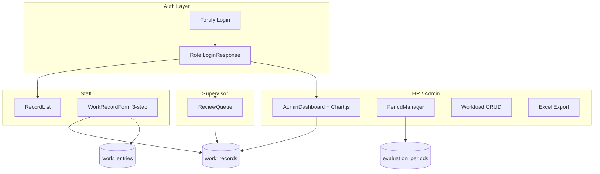

# SRU Workload Record — Implementation Plan

## Current state

The project is the **Laravel Livewire starter kit** (Fortify + Flux + Livewire 4), partially customized for SRU:

| Exists | Missing / broken |
|--------|------------------|
| Thai navbar ([`resources/views/layouts/app/navbar.blade.php`](resources/views/layouts/app/navbar.blade.php)) | All domain models, enums, policies, middleware |
| Role/status badges | User `role` column + helper methods (`isStaff()` etc.) |
| `WorkEntryCard` PHP class (no view) | Migrations, seeders, routes |
| `maatwebsite/excel`, `chart.js` in deps | Livewire pages, Excel export, Chart.js wiring |
| Cached SFCs in `storage/framework/views/livewire/` | Source files for WorkRecordForm + RecordList |

**Decisions confirmed:** Keep Fortify (role-based redirect only), use **Anuphan** font via Tailwind v4 `@theme` (no `tailwind.config.js` — project uses [`resources/css/app.css`](resources/css/app.css) + [`vite.config.js`](vite.config.js) Bunny font plugin).



---

## Phase 1 — Database & domain layer

### 1.1 Migrations (dependency order)

1. **`add_profile_and_role_to_users_table`** — extend [`database/migrations/0001_01_01_000000_create_users_table.php`](database/migrations/0001_01_01_000000_create_users_table.php) via new migration:
   - `position`, `department`, `faculty` (nullable strings)
   - `role` enum: `staff`, `supervisor`, `hr`, `admin` (default `staff`)

2. **`create_fiscal_years_table`** — `year` (int, unique), `is_active` (bool)

3. **`create_evaluation_periods_table`** — FK `fiscal_year_id`, `period` (tinyint 1|2), `label`, `start_date`, `end_date`, `status` enum (`draft`, `open`, `closed`)

4. **`create_workload_groups_table`** — FK `fiscal_year_id`, `name`, `icon`, `color`, `sort_order`

   - Workload structure is **scoped per fiscal year** (each FY has its own group/main/workload tree)
   - `WorkRecordForm` loads groups where `fiscal_year_id = selectedPeriod.fiscal_year_id`

5. **`create_workload_mains_table`** — FK `workload_group_id`, `name`, `sort_order`

6. **`create_workloads_table`** — FK `workload_main_id`, `name`, `sort_order`

7. **`create_work_records_table`** — FK `user_id`, `evaluation_period_id`, unique composite; `status`, `self_assessment`, `self_score`, `submitted_at`, `approved_at`, `rejection_comment` (nullable, used on reject)

8. **`create_work_entries_table`** — FK `work_record_id`, `workload_id`, `detail` (text), `result` (text), `hours` (decimal 5,1), `evidence` (nullable string), `evidence_type` enum (`url`, `file`, nullable), `sort_order`

   - **No `title` column** — entry identity uses workload name + truncated `detail` in UI lists

   - `evidence` stores either a validated URL or a storage path (e.g. `work-evidence/{work_record_id}/{uuid}.pdf`)
   - `evidence_type` disambiguates rendering (link vs download)

### 1.2 Enums — `app/Enums/`

| Enum | Values | Methods |
|------|--------|---------|
| `UserRole` | staff, supervisor, hr, admin | `label()` Thai |
| `WorkRecordStatus` | draft, submitted, approved, rejected | `label()` |
| `PeriodStatus` | draft, open, closed | `label()`, `isOpen()` |
| `EvaluationPeriodNumber` | One, Two | maps to 1/2 |

### 1.3 Models — `app/Models/`

Extend [`app/Models/User.php`](app/Models/User.php):
- Fillable: `position`, `department`, `faculty`, `role`
- Cast `role` → `UserRole`
- Helpers: `isStaff()`, `isSupervisor()`, `isHr()`, `isAdmin()`, `isHrOrAdmin()`
- `workRecords()` hasMany

Other models with relationships, fillable, casts (dates, enums, decimals):
- `FiscalYear` → hasMany `EvaluationPeriod`, `WorkloadGroup`; scope `active()`
- `EvaluationPeriod` → belongsTo `FiscalYear`; `isOpen()`; scope `open()`
- `WorkloadGroup` → belongsTo `FiscalYear`; hasMany `WorkloadMain`; ordered by `sort_order`; scope `forFiscalYear($id)`
- `WorkloadMain` → belongsTo group; hasMany `Workload`
- `Workload` → belongsTo main
- `WorkRecord` → belongsTo `User`, `EvaluationPeriod`; hasMany `WorkEntry`; methods `isEditable()`, `totalEntries()`, `totalHours()`
- `WorkEntry` → belongsTo `WorkRecord`, `Workload`; accessors `evidenceUrl()` (public URL for file or passthrough for URL type), `hasEvidence()`; delete stored file on model delete via observer or booted hook

### 1.4 Seeders

| Seeder | Content |
|--------|---------|
| `WorkloadStructureSeeder` | Full Thai tree **for FY 2568** (icons + colors) |
| `FiscalYearSeeder` | FY 2568 active; Period 1 (Oct–Mar) + Period 2 (Apr–Sep), both `open` |
| `UserSeeder` | admin@university.ac.th (admin), staff1–3@ (staff, same department), **supervisor@** (supervisor, same dept — needed to test review flow) — all password `password` |

Update [`database/seeders/DatabaseSeeder.php`](database/seeders/DatabaseSeeder.php) to call these instead of Test User.

---

## Phase 2 — Authorization & auth redirect

### 2.1 Policies — `app/Policies/`

**`WorkRecordPolicy`**
- `view`: owner OR (supervisor + same `department`) OR hr/admin
- `update` / `submit`: owner + status `draft|rejected` + period open
- `approve` / `reject`: supervisor (same dept) OR hr/admin; record must be `submitted`
- `delete`: owner draft only

**`EvaluationPeriodPolicy`**
- `manage` (open/close/CRUD): admin only (hr can view dashboard/export)

**`WorkloadStructurePolicy`**
- `manage`: admin only

Register in [`app/Providers/AppServiceProvider.php`](app/Providers/AppServiceProvider.php) via `Gate::policy()`.

### 2.2 Middleware — `app/Http/Middleware/EnsureUserHasRole.php`

Register alias `role` in [`bootstrap/app.php`](bootstrap/app.php). Apply on route groups: `role:staff`, `role:supervisor`, `role:hr,admin`, etc.

### 2.3 Fortify login redirect

Create `app/Http/Responses/LoginResponse.php` implementing `Laravel\Fortify\Contracts\LoginResponse`:

| Role | Redirect |
|------|----------|
| staff | `staff.records.index` |
| supervisor | `supervisor.review.index` |
| hr / admin | `hr.dashboard` |

Bind in `AppServiceProvider`. Change `/` and post-login home away from generic `dashboard`.

---

## Phase 3 — Livewire pages (Livewire 4 SFC pattern)

Follow existing convention from [`routes/settings.php`](routes/settings.php): `Route::livewire('path', 'pages::...')` with PHP+Blade in `resources/views/pages/{area}/⚡*.blade.php`, layout [`resources/views/layouts/app.blade.php`](resources/views/layouts/app.blade.php).

### 3.1 Staff — recover from cache + minor fixes

**`pages/staff/⚡record-list.blade.php`** — restore from [`storage/framework/views/livewire/views/600cb0de.blade.php`](storage/framework/views/livewire/views/600cb0de.blade.php):
- Group records by fiscal year
- Status badges, view/edit/print actions

**`pages/staff/⚡work-record-form.blade.php`** — based on cached wizard, with **modal-based entry editing** (see §3.1a):
- 3-step wizard (period cards → workload accordion → summary/self-assessment)
- Accordion lists workloads; each row shows saved entries as compact chips/rows (**truncated detail** + hours)
- **"+ เพิ่มผลงาน"** and **edit (✎)** open a **Flux modal** — no inline entry cards in the accordion
- **Evidence: upload OR URL** inside the modal (see §3.4)
- `wire:poll.10s="autoSave"`, sticky counter header, group color accents
- `saveDraft()`, `submit()` with Flux toasts

#### 3.1a Entry modal UX

Use `<flux:modal>` (Flux, already in project) driven by WorkRecordForm state:

| State property | Purpose |
|----------------|---------|
| `$entryModalOpen` | bool — modal visibility |
| `$modalWorkloadId` | which workload row triggered the modal |
| `$modalEntryIndex` | `null` = add new; int = edit existing |
| `$modalEntry` | draft fields: detail, result, hours, evidence_type, evidence, evidence_upload |

**Accordion row (Step 2):**
- Workload name + entry count badge
- List of saved entries: **detail preview** (truncated ~40 chars), hours, edit + delete (×) buttons
- "+ เพิ่มผลงาน" button (disabled when record not editable)

**Modal form fields:** รายละเอียดการดำเนินงาน*, ผลสำเร็จ / ผลที่ได้รับ, ชั่วโมง, evidence toggle (file/URL)

**Modal actions:**
- **บันทึก** — validate `detail` required (`min:10`); merge `$modalEntry` into `$entries[$modalWorkloadId]`; call `saveDraft(showToast: false)`; close modal; Flux toast "บันทึกผลงานแล้ว"
- **ยกเลิก** — discard draft; close modal (confirm if unsaved changes via Alpine `wire:dirty` or simple dirty flag)
- **ลบ** (edit mode only) — remove entry; save draft; close modal

**Read-only mode:** clicking an entry opens the same modal with fields disabled (view detail).

Remove orphaned [`app/Livewire/WorkEntryCard.php`](app/Livewire/WorkEntryCard.php) — replaced by modal + shared partial [`resources/views/components/work-entry-fields.blade.php`](resources/views/components/work-entry-fields.blade.php).

**Print view** — `resources/views/staff/print-record.blade.php` + controller route `staff.records.print` (read-only, `@media print` styles)

**Show route** — reuse WorkRecordForm in read-only mode (`mount($record)`, step 3, `isEditable() === false`; entry modal opens read-only)

### 3.2 Supervisor — new

**`pages/supervisor/⚡review-queue.blade.php`**
- List `WorkRecord` where `status = submitted` and `user.department = auth.department`
- Expandable row → entry detail (detail, result, hours, evidence) grouped by workload name — no title field
- Approve / Reject with comment textarea; sets `approved_at` or `rejection_comment` + status
- Flux toasts + `wire:loading` spinners

### 3.3 HR / Admin — new

**`pages/hr/⚡dashboard.blade.php`** (`AdminDashboard`)
- Filters: fiscal year, period, department
- Stats cards + **Chart.js** bar chart (records by status) — init in `resources/js/app.js` via `@script` or Alpine `x-init`
- Export button → `WorkRecordsExport` (maatwebsite/excel) download

**`pages/admin/⚡period-manager.blade.php`** (`PeriodManager`)
- CRUD fiscal years (set active)
- CRUD evaluation periods; toggle status draft/open/closed
- Thai labels, validation (no overlapping open periods per FY optional)
- Link to workload manager filtered by selected FY

**`pages/admin/⚡workload-manager.blade.php`**
- **FY selector** dropdown at top (defaults to active fiscal year)
- Nested CRUD scoped to selected FY: groups → mains → workloads
- Row-level **สำเนา** clone (group/main/workload) — see §3.3a
- Header action **คัดลอกไปยังปีงบประมาณหน้า** — see §3.3b
- Already linked from navbar (`admin.workloads`)

#### 3.3a Row-level clone (within same FY)

Each row gets a **สำเนา** icon button alongside edit/delete:

| Level | Behavior |
|-------|----------|
| Group | Deep clone group + all mains + workloads; name + ` (สำเนา)`; same `fiscal_year_id` |
| Main | Deep clone main + workloads; name + ` (สำเนา)` |
| Workload | Shallow clone; name + ` (สำเนา)` |

Actions: `app/Actions/CloneWorkloadGroup.php`, `CloneWorkloadMain.php`, `CloneWorkload.php` — `DB::transaction`, Flux confirm + toast. Cloned IDs are new; existing `work_entries` stay on originals.

#### 3.3b คัดลอกไปยังปีงบประมาณหน้า (copy to next fiscal year)

Primary rollover action in Workload Manager toolbar — duplicates **both** workload structure **and** evaluation period templates from the currently selected FY to the next Buddhist fiscal year (`year + 1`, e.g. 2568 → 2569).

**UI:**
- Button: **คัดลอกไปยังปีงบประมาณหน้า** (visible when a FY is selected)
- Flux confirm modal explains target year and what will be copied
- If target FY already has workload groups: second confirm **แทนที่โครงสร้างเดิม** or cancel

**`app/Actions/CopyStructureToNextFiscalYear.php`** (single transaction):

1. Resolve source FY from manager selection; target year = `source.year + 1`
2. `FiscalYear::firstOrCreate(['year' => targetYear], ['is_active' => false])`
3. **Evaluation periods:** for each source period, create target period with:
   - Same `period` (1|2), `label` (update year in label if present)
   - `start_date` / `end_date` shifted **+1 calendar year**
   - `status = draft` (admin opens manually when ready)
4. **Workload tree:** deep clone all source groups/mains/workloads → new rows with `fiscal_year_id = target FY`
   - Keep original names (no `สำเนา` suffix — this is a new FY copy, not a duplicate within same year)
5. Do **not** copy `work_records` / `work_entries` (historical data stays on source FY)
6. Flux toast: `คัดลอกโครงสร้างภาระงานและรอบประเมินไปยังปีงบประมาณ {year} เรียบร้อยแล้ว`
7. Redirect workload manager to target FY

**WorkRecordForm impact:** `workloadGroups()` computed property filters `WorkloadGroup::forFiscalYear($this->selectedPeriod->fiscalYear->id)` — staff always see the tree for their selected period's FY.

**Period Manager shortcut (optional):** same action linked from Period Manager as **คัดลอกจากปีก่อนหน้า** when creating a new empty FY.

### 3.4 Evidence — file upload OR URL

Each work entry supports **either** an attached file **or** an external URL (mutually exclusive per entry).

**UI (inside entry modal in WorkRecordForm):**
- Alpine toggle: `ไฟล์` / `ลิงก์` (default: URL if existing evidence is URL, file if stored path)
- **URL mode:** text input with validation `url|nullable|max:2048`
- **File mode:** `<input type="file">` via Livewire `WithFileUploads`; show filename + remove button when set
- Thai helper text: "อัปโหลดไฟล์ หรือ วาง URL"

**Upload handling (modal บันทึก + `saveDraft` / `submit`):**
- Use `Livewire\WithFileUploads` on WorkRecordForm
- Temp upload held in `$modalEntry['evidence_upload']` while modal is open
- On modal save / `saveDraft`: skip entries with empty `detail` (replaces old title check)
- On `saveDraft`/`submit`: store file to `work-evidence/{workRecordId}/` → `evidence_type = file`
- On save URL: set `evidence_type = url`, `evidence = trimmed URL`; clear any replaced file from storage
- Validation: max **10 MB**; MIME allowlist: `pdf`, `doc`, `docx`, `xls`, `xlsx`, `jpg`, `jpeg`, `png`, `webp`
- Replacing file→URL or URL→file deletes the old stored file

**Storage & access:**
- Disk: `public` (run `php artisan storage:link` in setup docs)
- Signed or public route `staff.evidence.download` for file evidence (authorize via `WorkRecordPolicy@view`)
- URL evidence rendered as external `<a target="_blank">` in form, review queue, and print view

**Review / print display:**
- File → "ดาวน์โหลดหลักฐาน" link
- URL → "เปิดลิงก์หลักฐาน" link

**Auto-save note:** poll interval **10 seconds** (`wire:poll.10s`). Persists `$entries` already saved to the array (closed modal entries). Open modal draft is **not** polled — user must click modal **บันทึก** or close after saving. File uploads processed on modal save only.

### 3.5 Shared UI components

Recreate missing [`resources/views/components/empty-state.blade.php`](resources/views/components/empty-state.blade.php) (recover from compiled cache — dashed border, emoji, slot for CTA).

Extract entry form fields into [`resources/views/components/work-entry-fields.blade.php`](resources/views/components/work-entry-fields.blade.php) (used inside the modal). Evidence sub-partial optional: `work-entry-evidence.blade.php`.

---

## Phase 4 — Routes — [`routes/web.php`](routes/web.php)

```php
// Role-based home redirect (auth)
Route::middleware(['auth', 'verified'])->group(function () {
    // Staff
    Route::middleware('role:staff')->prefix('staff')->name('staff.')->group(...);
    // Supervisor
    Route::middleware('role:supervisor')->prefix('supervisor')->name('supervisor.')->group(...);
    // HR + Admin dashboard
    Route::middleware('role:hr,admin')->prefix('hr')->name('hr.')->group(...);
    // Admin-only management
    Route::middleware('role:admin')->prefix('admin')->name('admin.')->group(...);
});
```

Named routes expected by navbar: `staff.records.index|create|show|edit|print`, `staff.evidence.download`, `supervisor.review.index`, `hr.dashboard`, `admin.periods`, `admin.workloads`.

---

## Phase 5 — Styling & assets

### Anuphan font (not Sarabun, not tailwind.config.js)

- [`vite.config.js`](vite.config.js): replace `Instrument Sans` → `Anuphan` (weights 400, 500, 600, 700)
- [`resources/css/app.css`](resources/css/app.css): `--font-sans: 'Anuphan', ...`
- Remove invalid `@source` for flux-pro (not installed)

### Chart.js

- Import in [`resources/js/app.js`](resources/js/app.js)
- Expose `window.Chart` or use Livewire `@script` block in dashboard

### Excel export

- `app/Exports/WorkRecordsExport.php` — columns: name, department, period, status, entries count, hours, submitted_at
- Controller action `hr.dashboard.export` with period/department query params

---

## Phase 6 — Verification commands

After implementation:

```bash
composer dump-autoload
php artisan storage:link
php artisan migrate:fresh --seed
npm run build
php artisan serve
```

**Smoke-test matrix:**

| User | Login | Expected landing |
|------|-------|------------------|
| staff1@ | password | บันทึกของฉัน |
| supervisor@ | password | ตรวจสอบผลงาน |
| admin@ | password | แดชบอร์ด |

Staff flow: create record → add entries (with file or URL evidence) → auto-save → submit → supervisor approve → staff sees approved badge.

Admin smoke-test: select FY 2568 → **คัดลอกไปยังปีงบประมาณหน้า** → verify FY 2569 has 4 groups + 2 draft periods with shifted dates.

---

## File creation order (as requested)

1. Migrations (8 files)
2. Enums (4) + Models (7) + User extension
3. Seeders (3) + DatabaseSeeder
4. Policies (3) + middleware + LoginResponse + clone/copy actions (4)
5. Livewire SFC pages (6) + print blade + evidence download route + export class
6. Blade components (empty-state, work-entry-fields, entry modal partial) + layouts (navbar already done)
7. Routes + bootstrap middleware alias
8. CSS/font/JS updates (Anuphan, Chart.js)

---

## Out of scope / deferred

- Replacing Fortify with Breeze
- Pest feature tests (not requested)
- `tailwind.config.js` (Tailwind v4 CSS-first config is the project standard)
